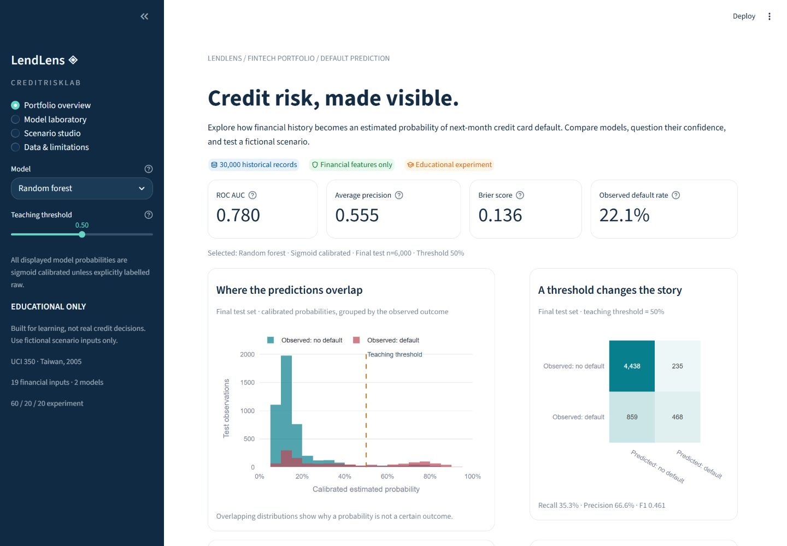
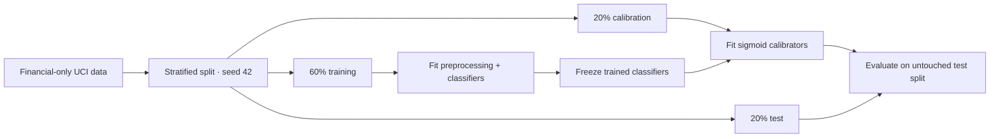

# LendLens · Credit Risk Lab
Streamlit App URL: https://cyscreditriskportfolio.streamlit.app/
An educational credit default dashboard built with **Python, Scikit-learn, and Streamlit**. Explore a historical credit card portfolio, compare logistic regression with a random forest, inspect probability calibration, and experiment with fictional financial profiles.

**Educational use only. This project is not suitable for real credit approval, pricing, lending decisions, or financial advice.** A credit card default label is not a general loan default or loan approval label.



## About the project

LendLens explores a central question in credit risk modeling: **how much can recent repayment and account history tell us about next-month default?** It compares two approaches to the same prediction task and makes their performance, probability estimates, and limitations visible in one interactive dashboard.

- Reproducible preprocessing and a stratified train / calibration / test design.
- Two supervised classifiers, a prevalence baseline, and separate probability calibration.
- ROC and precision–recall analysis, reliability diagrams, Brier score, log loss, and threshold-dependent classification metrics.
- Interactive portfolio visualizations and fictional profile predictions.
- Transparent explanations with clearly stated limits.
- Automated tests, continuous integration, and reproducible evaluation reports.

The dashboard is a learning and model-inspection tool. It returns estimated probabilities and diagnostic charts, with no approval, rejection, or lending recommendation.

## Explore the dashboard

| View | What you can explore |
|---|---|
| **Portfolio overview** | See the selected model's held-out metrics, probability distributions, confusion matrix, and aggregate repayment patterns. |
| **Model laboratory** | Compare raw and calibrated models with a prevalence baseline. Inspect ROC and precision–recall curves, calibration, training/test performance, and permutation importance. |
| **Scenario studio** | Choose an invented financial profile, edit its credit limit and six-month history, and compare estimated probabilities and local model sensitivities. |
| **Data & limitations** | Review the source dataset, financial feature selection, data quality, and limits of the experiment. |

Use the sidebar to switch between **logistic regression** and **random forest**. The **teaching threshold** changes the hypothetical classification boundary and error counts; it does not change the underlying estimated probabilities or represent a lending policy.

In Scenario studio, select a fictional preset, edit the financial inputs, and click **Explore this fictional scenario** to apply your changes. Results reflect the last submitted values. Use invented numbers only; no real customer data is needed.

For example, compare **Steady payments** with **Recent payment delays**, then inspect which inputs the model responds to. These are model-behavior comparisons, not evidence that changing one input would cause a real person's default risk to change.

## Data and prediction task

The project uses [UCI Default of Credit Card Clients, dataset 350](https://archive.ics.uci.edu/dataset/350/default+of+credit+card+clients), credited to I-Cheng Yeh. The original dataset contains **30,000 observations and 23 explanatory variables**, describing credit card clients in Taiwan and payment histories from April to September 2005. The binary response is default payment in the following month (`1` = default, `0` = no default). Amounts are in New Taiwan dollars (NT$).

Only **19 financial predictors** are retained in the bundled derivative: credit limit, six repayment status codes, six bill amounts, and six payment amounts. `ID`, `SEX`, `EDUCATION`, `MARRIAGE`, and `AGE` are excluded before modeling and are absent from the demo inputs and bundled CSV. The original target is renamed to `default`. See [data attribution](data/README.md) and the [data dictionary](docs/DATA_DICTIONARY.md).

Removing demographic attributes **does not demonstrate fairness**. Financial variables can be proxies for protected characteristics; historical outcomes can encode inequity. This derivative cannot support a demographic fairness audit because those attributes are deliberately absent.

The app shows aggregate historical analysis. Interactive profiles are made-up examples, never prefilled from a historical customer's row. Do not enter real personal or customer data.

## Modeling workflow



1. **Split first:** 18,000 training, 6,000 calibration, and 6,000 test observations, stratified by the target with seed 42. Test outcomes never fit preprocessing, classifiers, or calibrators.
2. **Preprocess within pipelines:** financial features are selected explicitly, missing numeric values are imputed from training data, and logistic regression uses scaling. Repayment status codes are treated as categories rather than assuming that special codes form a meaningful numeric scale. Financial ratios are engineered with guarded denominators.
3. **Fit fixed model configurations:** logistic regression gives an interpretable baseline; a bounded random forest captures nonlinear relationships. Hyperparameters are specified in source rather than optimized against test scores. No oversampling or synthetic customers are used for training.
4. **Calibrate separately:** sigmoid calibration uses `CalibratedClassifierCV` with a frozen fitted estimator on the calibration split. Calibration can improve or worsen a metric and does not establish reliability outside this historical distribution.
5. **Evaluate honestly:** compare raw and calibrated probabilities with a prevalence baseline. Accuracy alone is misleading for an imbalanced target. ROC AUC measures ranking; average precision emphasizes the positive class; Brier score and log loss assess probabilistic predictions; a reliability diagram compares mean predicted probability with observed frequency. Small bins are noisy.
6. **Explore thresholds:** changing the demonstration threshold changes false positives and false negatives, not the underlying probabilities. Interactive test-set inspection is exploratory; once used to make design decisions it no longer provides a fresh final performance estimate.

The exact model settings, feature transformations, intended uses, and limitations are recorded in the [model card](docs/MODEL_CARD.md). Reproduce measured results with the training script below; the checked-in `reports/` files record an actual run rather than a promised performance level.

## Measured results

The bundled report was generated with the full 30,000-row derivative, seed 42, and a 6,000-row held-out test set. Classification uses the fixed teaching threshold of 0.50.

| Model | Probability version | ROC AUC ↑ | Average precision ↑ | Brier score ↓ | Recall at 0.50 |
|---|---|---:|---:|---:|---:|
| Logistic regression | Raw | 0.758 | 0.522 | 0.1393 | 35.3% |
| Logistic regression | Calibrated | 0.758 | 0.522 | 0.1392 | 34.7% |
| Random forest | Raw | 0.780 | 0.555 | 0.1347 | 35.4% |
| Random forest | Calibrated | 0.780 | 0.555 | 0.1356 | 35.3% |
| Training-prevalence baseline | Constant probability | 0.500 | 0.221 | 0.1723 | 0.0% |

Calibration slightly improves logistic probability error and slightly worsens the forest's error on this split. Sigmoid calibration preserves ranking here, so ROC AUC and average precision are unchanged. At 0.50, both models miss many observed defaults; these metrics do not establish suitability for lending. See [full results](reports/model_comparison.csv) and [experiment metadata](reports/metrics.json).

The splits have disjoint row indices but **not completely distinct financial histories**: 175 of 6,000 test rows share an identical financial feature vector with a training row, and 142 with a calibration row. These counts can overlap. Repeated histories can make a random-split estimate optimistic. [Split diagnostics](reports/splits.json) report the exact definition and overlap counts; a future grouped-history validation would be a useful robustness study.

All **45 tests passed**, including the real-data Streamlit flow. See [validation notes](docs/VALIDATION.md).

For an overfitting check, [raw training/test diagnostics](reports/train_test_comparison.csv) show logistic train/test ROC AUC of **0.778 / 0.758** and forest **0.849 / 0.780**. Training scores reuse fitted rows and are optimistic. The larger forest gap is a useful discussion point, not a reason to tune against this test split.

## Explanations: what the charts mean

- **Logistic contributions:** additive feature contributions explain the raw classifier's log-odds. They do not directly add to the calibrated probability. One-hot encoded categories and scaled numeric features have model-specific units.
- **Reference substitution:** change one financial input to a training-reference value (median amount or modal repayment category) and recompute a prediction. The difference is a local model sensitivity, depends on that reference, and is not additive. Correlated inputs and implausible combinations can make the result misleading.
- **Permutation importance:** shuffle one input in a held-out evaluation sample and measure the loss in ranking performance. Correlated variables can share importance; negative values and variability are possible. This evaluates model reliance, not a causal driver of default.

None of these methods identifies the cause of an individual's outcome, provides an approved adverse-action explanation, or tells a person how to obtain credit.

## Limitations

This dataset is an old, geographically specific snapshot of existing credit card accounts. A random split within that snapshot is not a future-period, cross-country, or new-applicant validation. Identical financial histories can cross split boundaries and make evaluation optimistic.

Probability estimates are not individual guarantees or calibrated forecasts for current borrowers. Removing demographics does not remove proxy bias or establish fairness. The dataset does not support an affordability assessment or expected-loss model, and the explanations describe model associations rather than causes.

**Do not use this system for decisions about real people.** Read the [model card](docs/MODEL_CARD.md) for the full intended-use statement, validation design, and limitations.

## Run the app locally

Use **Python 3.12** from the folder containing `app.py`. The financial-only dataset is bundled, and no account, API key, or runtime data download is required.

**Windows PowerShell**

```powershell
py -3.12 -m venv .venv
.\.venv\Scripts\python.exe -m pip install -r requirements.txt
.\.venv\Scripts\python.exe -m streamlit run app.py
```

**macOS / Linux**

```bash
python3.12 -m venv .venv
.venv/bin/python -m pip install -r requirements.txt
.venv/bin/python -m streamlit run app.py
```

Open the localhost URL printed by Streamlit. The first start fits and calibrates both models in memory; subsequent interactions reuse the cached models. A process restart requires training again. Requirements apply `constraints.txt` to retain the tested dependency versions. Optional hosting configuration is documented separately in [deployment notes](docs/DEPLOYMENT.md).

## Reproduce the analysis

The normal app run uses the bundled `data/credit_default.csv.gz`. The download script fetches the original public UCI archive, validates its structure, selects the financial allowlist, and writes the derivative. It requires internet access and `xlrd`, which is included in the development requirements.

```bash
python -m pip install -r requirements-dev.txt
python scripts/download_data.py
python scripts/train.py --importance
```

Run these commands with your virtual environment's Python, or activate the environment first. See `--help` on each script for supported paths and options. Dataset licensing is separate from code licensing. Preserve the attribution when redistributing the derived CSV. Do not add untrusted serialized model files to the app.

## Tests

Install the development dependencies, then run from the repository root:

```bash
python -m pip install -r requirements-dev.txt
python -m pytest
```

Tests exercise the feature allowlist, invalid inputs, deterministic disjoint splits, train-only preprocessing, calibrated probability boundaries, metric consistency, and explanation semantics. A Streamlit smoke test checks the app for runtime exceptions. Most backend tests use deterministic synthetic financial records; they test software behavior rather than claim real-world predictive validity. GitHub Actions runs the test suite on Python 3.12.

The integration test trains on the bundled UCI derivative and visits all four pages, both models, and a fictional form submission. For a faster backend-only check, run `python -m pytest -m "not integration"`.

## Repository structure

```text
app.py                    Streamlit entrypoint
credit_risk/              Data validation, preprocessing, models, explanations
scripts/download_data.py  Rebuild the financial-only UCI derivative
scripts/train.py          Reproduce evaluation artifacts
data/                     Compressed public dataset and attribution
reports/                  Reproducible measured evaluation outputs
docs/                     Model card and data dictionary
tests/                    Backend and application checks
.streamlit/config.toml    Theme and server configuration
.github/workflows/ci.yml  Automated Python test run
requirements.txt          Pinned application dependencies
requirements-dev.txt      Testing dependencies
constraints.txt           Tested transitive dependency versions
```

## References and licensing

- Yeh, I. (2009). *Default of Credit Card Clients* [Dataset]. UCI Machine Learning Repository. [DOI: 10.24432/C55S3H](https://doi.org/10.24432/C55S3H). Dataset license: [CC BY 4.0](https://creativecommons.org/licenses/by/4.0/).
- [Scikit-learn probability calibration](https://scikit-learn.org/1.7/modules/calibration.html) and [model evaluation](https://scikit-learn.org/1.7/modules/model_evaluation.html).
- [Streamlit documentation](https://docs.streamlit.io/).

Project source code is licensed under [MIT](LICENSE). The UCI dataset and its derived CSV retain their separate attribution and CC BY 4.0 terms.
